# AI Sessions – Freigaben: Unterbefehle & autoApprove-Regel

Technische Dokumentation der Änderung am Analyse-Tab, Karte **„Freigaben (Approve) · GitHub Copilot“**, Liste **„Manuell erlaubte Terminal-Befehle“**.

- Extension: `schueri.ai-sessions` 0.42.0
- Stand: 2026-10-12
- Geänderte Dateien: `lib/analytics.js`, `lib/boardPanel.js`
- Umgesetzt direkt in der installierten Kopie unter `%USERPROFILE%\.vscode\extensions\schueri.ai-sessions-0.42.0\` → **muss ins Quell-Repo übernommen werden**, sonst beim nächsten Update weg.

---

## 1. Ziel

| Anforderung | Umsetzung |
|---|---|
| Befehle teilweise aufgedröselt sehen (z. B. `git` → `status`, `diff`, …) | Unterbefehle als Chips unter der jeweiligen Zeile (Variante **A**) |
| Liste nicht weiter aufblähen | Weiterhin Top 8 Programme; max. 5 Chips pro Zeile, Rest als `+N` mit Tooltip |
| Nutzen für autoApprove | Button **„Regel kopieren“** erzeugt eine Regel für `chat.tools.terminal.autoApprove` (Variante **D**) |
| Verkettete Befehle getrennt zählen | `;`, `&&`, `\|\|` und Zeilenumbrüche werden aufgeteilt, jeder Teil wird gezählt |

Ergebnis (echte Daten, 30 Tage):

```
git            198 (19%)   [Regel kopieren]
████████████
[diff 60] [show 58] [log 35] [status 23] [grep 23] +N
get-content    132 (13%)   [Regel kopieren]
████████
...
```

---

## 2. Datenfluss

```mermaid
flowchart LR
  A[Copilot Chat JSONL<br/>workspaceStorage/*/chatSessions] --> B[analytics.js<br/>Copilot-Turn-Parser]
  B -->|toolInvocationSerialized.isConfirmed<br/>+ toolSpecificData.commandLine| C[terminalCommands]
  C -->|"approvals[].commands = [{cmd, sub}]"| D[fileTurnCache]
  D --> E[aggregateScope<br/>manualCommandMap]
  E -->|"approvals.topCommands[]"| F[boardPanel.js Webview<br/>renderApprovals]
  F --> G[renderApprovalCommands<br/>Chips + Regel-Button]
  G -->|navigator.clipboard| H[autoApprove-Regel]
```



Quelle der Freigabe-Art ist `isConfirmed.type` (VS Code `ToolConfirmKind`): `0` Denied, `1` ConfirmationNotNeeded, `2` Setting, `3` LmServicePerTool (gemerkt), **`4` UserAction (= manuell)**, `5` Skipped. Nur `type === 4` fließt in die Befehlsliste.

---

## 3. `lib/analytics.js`

### 3.1 Neue Konstanten (nach `APPROVAL_MANUAL`)

```js
const APPROVAL_MANUAL = 4;
// Bump when the shape of cached Copilot turns changes.
const COPILOT_TURN_CACHE_VERSION = 2;

// Programs whose first non-option argument is a meaningful subcommand (git status, npm install, ...).
const SUBCOMMAND_PROGRAMS = new Set(['git', 'gh', 'npm', 'npx', 'pnpm', 'yarn', 'dotnet', 'docker', 'kubectl', 'az', 'mvn', 'pip', 'cargo', 'go', 'winget', 'choco', 'code']);
// git global options that consume the following token as their value.
const GIT_VALUE_OPTIONS = new Set(['-c', '-C', '--git-dir', '--work-tree', '--namespace', '--exec-path']);
```

- **`SUBCOMMAND_PROGRAMS`** ist bewusst eine Whitelist. Ohne sie würden bei `get-childitem C:\x` oder `node script.js` Pfade/Argumente als „Unterbefehl“ erscheinen.
- **`GIT_VALUE_OPTIONS`**: git-Optionen, deren Wert als eigenes Token folgt (`git -C <pfad> status`). Wert wird übersprungen, damit nicht `<pfad>` als Unterbefehl erkannt wird.

### 3.2 `splitCommandChain(raw)` – neu

Ersetzt das bisherige `String(raw).split(/;|&&|\|\||\r?\n/)`.

```js
// Splits on ; && || and newlines outside of quotes; single pipes stay part of their command.
function splitCommandChain(raw) {
  const parts = [];
  let cur = '';
  let quote = '';
  for (let i = 0; i < raw.length; i++) {
    const ch = raw[i];
    if (quote) {
      if (ch === quote) quote = '';
      cur += ch;
      continue;
    }
    if (ch === '"' || ch === "'") {
      quote = ch;
      cur += ch;
      continue;
    }
    const two = raw.substr(i, 2);
    if (two === '&&' || two === '||') {
      parts.push(cur);
      cur = '';
      i++;
      continue;
    }
    if (ch === ';' || ch === '\n' || ch === '\r') {
      parts.push(cur);
      cur = '';
      continue;
    }
    cur += ch;
  }
  parts.push(cur);
  return parts;
}
```

Unterschied zum alten Regex-Split: Trenner **innerhalb von Anführungszeichen** werden ignoriert – `git commit -m "fix; refactor"` bleibt ein Befehl.

**Bewusst nicht getrennt:** einfache Pipes `|`. Sonst würden `select-object`, `format-table`, `where-object` usw. die Top-8 dominieren, obwohl sie nur Filter des eigentlichen Befehls sind.

### 3.3 `subcommandOf(program, rest)` – neu

```js
function subcommandOf(program, rest) {
  if (!SUBCOMMAND_PROGRAMS.has(program)) return '';
  const tokens = rest.trim().split(/\s+/);
  for (let i = 0; i < tokens.length; i++) {
    const t = tokens[i].replace(/\)+$/, '');
    if (!t) continue;
    if (program === 'git' && GIT_VALUE_OPTIONS.has(t)) {
      i++;
      continue;
    }
    if (t.startsWith('-')) continue;
    return /^[a-z0-9][\w:.-]*$/i.test(t) ? t.toLowerCase() : '';
  }
  return '';
}
```

Regeln:
1. Nur für Programme aus `SUBCOMMAND_PROGRAMS`.
2. Optionen (`-x`, `--xyz`) werden übersprungen; bei git zusätzlich der Wert von `GIT_VALUE_OPTIONS`.
3. Erstes Nicht-Options-Token = Unterbefehl, aber nur wenn es wie ein Bezeichner aussieht (`^[a-z0-9][\w:.-]*$`). Pfade, Variablen (`$x`), Strings → kein Unterbefehl.
4. Schließende Klammern werden entfernt: `(git diff)` → `diff`.
5. Immer lowercase (PowerShell ist case-insensitive, Zählung soll nicht splitten).

### 3.4 `terminalCommands(toolSpecificData)` – ersetzt `terminalCommandKey()`

Rückgabe vorher: **ein** String (Hauptprogramm des ersten Kettenglieds).
Rückgabe jetzt: **Array** `{ cmd, sub }` aller Kettenglieder.

```js
// Every command of a (chained) terminal command line as { cmd, sub }, ignoring cd and leading variable assignments.
function terminalCommands(toolSpecificData) {
  const cl = toolSpecificData && toolSpecificData.kind === 'terminal' ? toolSpecificData.commandLine : null;
  const raw = cl && (cl.userEdited || cl.toolEdited || cl.original);
  if (!raw) return [];
  const result = [];
  for (const seg of splitCommandChain(String(raw))) {
    const s = seg.trim().replace(/^&\s*/, '').replace(/^\$[\w:]+\s*=\s*/, '').replace(/^@?\(+/, '');
    if (!s) continue;
    const m = s.match(/^\[[^\]]+\]::\w+|^"([^"]+)"|^'([^']+)'|^[^\s(]+/);
    let first = m ? (m[1] || m[2] || m[0]) : '';
    // A quoted token is a program only if it looks like a path ("C:\...\git.exe"), otherwise it's a string literal being output.
    if (m && (m[1] || m[2]) && !/[\\/]|\.exe$/i.test(first)) continue;
    first = first.split(/[\\/]/).pop().replace(/\.exe$/i, '');
    if (!first || /^(cd|set-location|sl|push-location|pushd|pop-location|popd|chdir)$/i.test(first)) continue;
    // Shell keywords and variable statements ($i++) are not commands that could be auto-approved.
    if (/^(if|elseif|else|foreach|for|while|do|switch|try|catch|finally|function|return|[{}])$|^\$/i.test(first)) continue;
    first = first.toLowerCase();
    result.push({ cmd: first, sub: subcommandOf(first, s.slice(m[0].length)) });
  }
  return result;
}
```

Übernommen aus der alten Logik:
- Präfixe entfernen: Call-Operator `& `, Zuweisung `$x = `, `@(` / `(`.
- Programmname: .NET-Static-Call (`[io.file]::readalltext`), gequoteter Pfad, oder erstes Token; Pfad und `.exe` werden abgeschnitten.
- Navigationsbefehle (`cd`, `set-location`, `push-location`, …) werden ignoriert.

Neu hinzugekommen (weil durch das Aufsplitten Rauschen sichtbar wurde – an echten Daten verifiziert):

| Filter | Grund | Beispiel vorher in der Liste |
|---|---|---|
| `pop-location` / `popd` | Gegenstück zu bereits ignoriertem `push-location` | `pop-location 19` |
| Schlüsselwörter (`foreach`, `if`, `while`, `try`, `{`, `}` …) | Sprachkonstrukte, keine Befehle; keine autoApprove-Regel möglich | `foreach 78`, `if 29` |
| Token beginnt mit `$` | Variablen-Anweisungen wie `$i++`, `$x += 1` | `$i 12` |
| Gequoteter Token ohne `\`/`/`/`.exe` | PowerShell-String-Literal, das nur ausgegeben wird (`; "---";`) | `--- 16` |

Beispiele (Unit-getestet):

| Eingabe | Ergebnis |
|---|---|
| `cd I:\x; git -C foo status; git add . && git commit -m "a; b" \|\| npm run build` | `git/status`, `git/add`, `git/commit`, `npm/run` |
| `Get-ChildItem C:\x \| Select-String foo` | `get-childitem` (ohne sub) |
| `$x = git log --oneline -5` | `git/log` |
| `(git diff)` | `git/diff` |
| `& "C:\Program Files\Git\bin\git.exe" --no-pager show HEAD` | `git/show` |
| `npx playwright test` ⏎ `npm --version` | `npx/playwright`, `npm` (ohne sub) |

### 3.5 `escapeRegex(str)` – neu

```js
function escapeRegex(str) {
  return str.replace(/[.*+?^${}()|[\]\\]/g, '\\$&');
}
```

Wird **serverseitig** (Extension-Host) angewendet, damit das Webview keine Regex-Escapes bauen muss (siehe 4.4 Template-Literal-Falle).

### 3.6 Turn-Parser (Copilot)

```js
approvals.push({
  tool: p.toolId || p.name,
  type: ic.type,
  scope: ic.scope || '',
  commands: terminalCommands(p.toolSpecificData)   // vorher: command: terminalCommandKey(...)
});
```

### 3.7 Cache-Invalidierung

Der `fileTurnCache` (in-memory `Map`, pro JSONL-Datei) erkannte alte Einträge bisher nur an `turns[0].approvals === undefined`. Das reicht für die neue Feldstruktur nicht. Umgestellt auf eine Versionsnummer:

```js
// Prüfung
if (!cached || cached.mtimeMs !== stat.mtimeMs || cached.size !== stat.size || cached.v !== COPILOT_TURN_CACHE_VERSION) {

// Speichern
cached = { v: COPILOT_TURN_CACHE_VERSION, mtimeMs: stat.mtimeMs, size: stat.size, turns: fileTurns };
```

> Bei künftigen Änderungen an der Turn-Struktur einfach `COPILOT_TURN_CACHE_VERSION` erhöhen. Betrifft nur den Copilot-Zweig; Claude/Codex/Antigravity nutzen denselben `fileTurnCache`, aber eigene Prüfungen.

### 3.8 Aggregation (`aggregateScope`, Abschnitt „6. Tool approvals“)

`manualCommandMap` ist jetzt `Map<cmd, { count, subs: Map<sub, count> }>`.

```js
// A program counts once per approval, but each distinct subcommand of the chain counts separately.
const seenCmds = new Set();
const seenSubs = new Set();
for (const c of (a.commands || [])) {
  let entry = manualCommandMap.get(c.cmd);
  if (!entry) {
    entry = { count: 0, subs: new Map() };
    manualCommandMap.set(c.cmd, entry);
  }
  if (!seenCmds.has(c.cmd)) {
    seenCmds.add(c.cmd);
    entry.count++;
  }
  const subKey = c.cmd + '\0' + c.sub;
  if (c.sub && !seenSubs.has(subKey)) {
    seenSubs.add(subKey);
    entry.subs.set(c.sub, (entry.subs.get(c.sub) || 0) + 1);
  }
}
```

**Zählsemantik:**

| Freigabe | `git` | `npm` | Chips |
|---|---|---|---|
| `git status` | +1 | – | `status` +1 |
| `git add .; git commit; git push` | +1 | – | `add`, `commit`, `push` je +1 |
| `git status; git status` | +1 | – | `status` +1 (dedupliziert) |
| `git pull && npm ci` | +1 | +1 | `pull` +1, `ci` +1 |

Warum das Programm nur **einmal pro Freigabe**: Die Prozentangabe ist „Anteil der manuellen Freigaben, die dieses Programm enthalten“ und bleibt damit ≤ 100 %. Würde jedes Kettenglied zählen, könnte `git` bei langen Ketten über 100 % kommen. Die Summe aller Zeilen kann > 100 % sein (eine Freigabe mit `git` und `npm` zählt bei beiden) – das ist gewollt.

### 3.9 Ergebnisstruktur `approvals.topCommands`

```js
approvals.topCommands = Array.from(manualCommandMap.entries())
  .map(([name, e]) => ({
    name,
    count: e.count,
    percent: approvals.manual > 0 ? Math.round((e.count / approvals.manual) * 100) : 0,
    re: escapeRegex(name),
    hasSubcommands: SUBCOMMAND_PROGRAMS.has(name),
    subs: Array.from(e.subs.entries())
      .map(([sub, count]) => ({ name: sub, count, re: escapeRegex(sub) }))
      .sort((x, y) => y.count - x.count)
  }))
  .sort((x, y) => y.count - x.count)
  .slice(0, 8);
```

```ts
type TopCommand = {
  name: string;            // "git"
  count: number;           // Freigaben, die das Programm enthalten
  percent: number;         // count / approvals.manual
  re: string;              // regex-escaped name
  hasSubcommands: boolean; // Programm in SUBCOMMAND_PROGRAMS
  subs: { name: string; count: number; re: string }[]; // absteigend sortiert, ungekürzt
};
```

`topTools` nutzt weiterhin das generische `toTop()` – unverändert.

---

## 4. `lib/boardPanel.js` (Webview)

### 4.1 CSS (nach `.tool-bar-fill`)

Nur VS-Code-Theme-Variablen bzw. halbtransparente Farben → hell/dunkel kompatibel.

```css
.cmd-actions { display: inline-flex; align-items: center; gap: 8px; }
.cmd-rule-btn {
  font-size: 11.5px;
  padding: 1px 8px;
  border-radius: 10px;
  cursor: pointer;
  border: 1px solid var(--vscode-widget-border, rgba(128, 128, 128, 0.25));
  background: transparent;
  color: var(--vscode-textLink-foreground, #3794ff);
}
.cmd-rule-btn:hover:not(:disabled) { background: var(--vscode-button-secondaryHoverBackground, rgba(128, 128, 128, 0.2)); }
.cmd-rule-btn:disabled { opacity: 0.4; cursor: default; }
.cmd-subs { display: flex; flex-wrap: wrap; gap: 4px; margin-top: 2px; }
.cmd-sub {
  font-family: var(--vscode-editor-font-family, monospace);
  font-size: 11.5px;
  padding: 1px 7px;
  border-radius: 10px;
  cursor: pointer;
  border: 1px solid #10b981;
  background: rgba(16, 185, 129, 0.15);
  color: inherit;
}
.cmd-sub.off { border-color: var(--vscode-widget-border, rgba(128, 128, 128, 0.25)); background: transparent; opacity: 0.6; }
.cmd-sub .count { opacity: 0.75; margin-left: 4px; }
.cmd-sub-more { font-size: 11.5px; opacity: 0.6; padding: 1px 4px; cursor: help; }
```

Grün (`#10b981`) entspricht der bestehenden Balkenfarbe der Befehlsliste.

### 4.2 Header-Tooltip

`title` von „Manuell erlaubte Terminal-Befehle“ erweitert um: *„Verkettete Befehle (;, &&, ||) werden einzeln gezählt. Unterbefehle anklicken, um sie in die kopierte Regel aufzunehmen oder auszuschließen.“*

### 4.3 Neuer Webview-State & Funktionen (vor `renderApprovals`)

```js
// Read-only subcommands are preselected for the autoApprove rule; everything else must be opted in.
const SAFE_SUBCOMMANDS = new Set([
  'git status', 'git diff', 'git log', 'git show', 'git blame', 'git ls-files', 'git ls-tree', 'git rev-parse', 'git describe', 'git shortlog',
  'npm ls', 'npm list', 'npm outdated', 'npm view', 'npm info',
  'docker ps', 'docker images', 'docker logs', 'docker inspect', 'docker version', 'docker info',
  'kubectl get', 'kubectl describe', 'kubectl logs', 'kubectl version', 'kubectl explain',
  'pip list', 'pip show', 'pip freeze',
  'winget list', 'winget search', 'winget show',
  'choco list', 'choco search', 'choco info'
]);
const MAX_VISIBLE_SUBS = 5;
const subSelection = new Map();   // "git push" -> true/false (überschreibt Default)
let approvalCommands = [];        // letzte topCommands, Basis für Re-Render & Klicks
```

| Element | Zweck |
|---|---|
| `SAFE_SUBCOMMANDS` | Default-Auswahl. **Safe-by-default:** Nur rein lesende Unterbefehle sind vorausgewählt. Alles Unbekannte und alles Schreibende (`push`, `reset`, `commit`, `run`, `install`, …) muss bewusst angeklickt werden. |
| `subSelection` | Manuelle Überschreibungen pro `"cmd sub"`. Lebt im Webview-Scope → bleibt bei Daten-Refresh erhalten, geht beim Schließen des Panels verloren (kein Persistieren nötig). |
| `MAX_VISIBLE_SUBS` | 5 Chips sichtbar, Rest als `+N`. Nur sichtbare Chips gehen in die Regel. |

#### `isSubSelected(cmd, sub)`

```js
function isSubSelected(cmd, sub) {
  const key = cmd + ' ' + sub;
  return subSelection.has(key) ? subSelection.get(key) : SAFE_SUBCOMMANDS.has(key);
}
```

#### `buildAutoApproveRule(c)`

```js
function buildAutoApproveRule(c) {
  // Backslash via char code: this script lives inside a template literal.
  const bs = String.fromCharCode(92);
  let pattern;
  if (c.hasSubcommands) {
    const picked = (c.subs || []).slice(0, MAX_VISIBLE_SUBS).filter((s) => isSubSelected(c.name, s.name)).map((s) => s.re);
    if (picked.length === 0) return '';
    pattern = '/^' + c.re + bs + 's+(' + picked.join('|') + ')' + bs + 'b/i';
  } else {
    pattern = '/^' + c.re + bs + 'b/i';
  }
  return JSON.stringify(pattern) + ': true';
}
```

| Fall | Ergebnis |
|---|---|
| `git`, Auswahl `status, diff, ls-files` | `"/^git\\s+(status\|diff\|ls-files)\\b/i": true` |
| `git`, nichts ausgewählt | `''` → Button deaktiviert |
| `npm`, nur `run` (nicht safe) | `''` → Button deaktiviert, bis `run` angeklickt wird |
| `get-childitem` (kein Unterbefehl-Programm) | `"/^get-childitem\\b/i": true` + Warn-Tooltip |

Details:
- Format `/pattern/flags` wird von `chat.tools.terminal.autoApprove` als Regex interpretiert; `i` wegen PowerShell-Case-Insensitivity.
- `\s+` statt Leerzeichen, `\b` am Ende verhindert Präfix-Treffer (`status` matcht nicht `statusx`).
- `JSON.stringify` verdoppelt die Backslashes → Ausgabe ist direkt als Zeile in `settings.json` einfügbar.
- Programme **mit** Unterbefehlen bekommen nie eine Regel ohne Unterbefehl-Einschränkung → keine versehentliche Freigabe von `git` komplett.

Verifiziert per Regex-Test: `git status -s` ✓, `Git  push origin` ✓ (wenn ausgewählt), `git stash` ✗, `git statusx` ✗.

#### `renderApprovalCommands()`

Rendert die Liste aus `approvalCommands`. Pro Zeile:

```
<div class="tool-row">
  <div class="tool-meta">
    <span class="tool-name">git</span>
    <span class="cmd-actions">
      <span class="tool-count">198 (19%)</span>
      <button class="cmd-rule-btn" data-ci="0" [disabled] title="…Regel…">Regel kopieren</button>
    </span>
  </div>
  <div class="tool-bar-track"><div class="tool-bar-fill" …></div></div>
  <div class="cmd-subs">
    <button class="cmd-sub [off]" data-ci="0" data-si="0">diff<span class="count">60</span></button>
    …
    <span class="cmd-sub-more" title="branch 21, fetch 12, …">+7</span>
  </div>
</div>
```

- Referenzierung per **Index** (`data-ci`, `data-si`) statt Name → keine Werte aus Befehlszeilen in Attributen, die zurückgelesen werden müssen.
- Tooltip des Buttons zeigt die exakte Regel (Vorschau vor dem Kopieren).
- `.cmd-subs` wird nur gerendert, wenn Chips vorhanden sind (z. B. nicht bei `get-content`).

#### Klick-Handling (Event-Delegation, einmalig registriert)

```js
const approvalsCommandsEl = document.getElementById('approvals-commands');
if (approvalsCommandsEl) {
  approvalsCommandsEl.addEventListener('click', (ev) => {
    const btn = ev.target.closest('button[data-ci]');
    if (!btn) return;
    const c = approvalCommands[Number(btn.dataset.ci)];
    if (!c) return;
    if (btn.classList.contains('cmd-sub')) {
      const s = (c.subs || [])[Number(btn.dataset.si)];
      if (!s) return;
      subSelection.set(c.name + ' ' + s.name, !isSubSelected(c.name, s.name));
      renderApprovalCommands();
      return;
    }
    const rule = buildAutoApproveRule(c);
    if (!rule) return;
    navigator.clipboard.writeText(rule).then(() => {
      btn.textContent = '✓ Kopiert';
      setTimeout(() => { btn.textContent = 'Regel kopieren'; }, 1200);
    });
  });
}
```

- Delegation auf den Container, weil `innerHTML` bei jedem Render neu gesetzt wird.
- Clipboard direkt im Webview (`navigator.clipboard`), wie bereits bei `copyId`/`copyCwd` – keine Message an den Extension-Host nötig.

#### Anpassung in `renderApprovals()`

Der alte Inline-Block „Top Commands“ wurde ersetzt durch:

```js
// Top Commands
approvalCommands = a.topCommands || [];
renderApprovalCommands();
```

Der Leerzustand (`a.total === 0`) setzt die Liste weiterhin direkt auf „Keine Einträge“.

### 4.4 Falle: Webview-Script liegt in einem Template-Literal

`BoardPanel.html()` gibt das komplette HTML inkl. `<script>` als **Backtick-String** zurück. Für Code im Script gilt daher:

| Im Quelltext | Landet im Webview als | Konsequenz |
|---|---|---|
| `'\n'` | echter Zeilenumbruch im String | **SyntaxError** im Webview → `'\\n'` schreiben |
| `'\\b'`, `/\s/` | `'\b'` bzw. `/s/` | Regex/Escapes kaputt → Backslash per `String.fromCharCode(92)` oder serverseitig vorberechnen |
| `${…}` | Template-Interpolation zur Build-Zeit | vermeiden, String-Konkatenation nutzen |

Deshalb:
- Regex-Escaping (`re`-Felder) passiert in `analytics.js` (normales JS).
- Die Regel-Backslashes kommen aus `String.fromCharCode(92)`.
- Tooltip-Zeilenumbrüche sind als `'\\n'` geschrieben (wie im bestehenden Code, z. B. `tooltipParts.join('\\n')`).

Prüfung: `node test/check-webviews.js` extrahiert das Script aus `html()` und kompiliert es mit `vm.Script`.

---

## 5. Sicherheit

| Thema | Maßnahme |
|---|---|
| **XSS im Webview** | Programm- und Unterbefehlsnamen stammen aus vom Modell erzeugten Befehlszeilen (= nicht vertrauenswürdig). Alle Ausgaben laufen durch `escapeHtml()` (Name, Chip-Text, `+N`-Tooltip, Button-Tooltip). Unterbefehle sind zusätzlich auf `^[a-z0-9][\w:.-]*$` beschränkt. |
| **Attribut-Injection** | Klick-Ziele über numerische Indizes (`data-ci`/`data-si`), nicht über Namen. |
| **Zu weite autoApprove-Regeln** | Safe-by-default-Vorauswahl; Programme mit Unterbefehlen nie ohne Einschränkung; `\b`-Anker; Warn-Tooltip bei Komplettfreigabe einfacher Befehle. Regel wird nur kopiert, nie automatisch in die Settings geschrieben. |
| **Regex-Injection** | Namen werden vor dem Einbau in die Regel mit `escapeRegex()` escaped. |

---

## 6. Tests / Verifikation

| Test | Ergebnis |
|---|---|
| `node --check lib/analytics.js` / `lib/boardPanel.js` | OK |
| `node test/check-webviews.js` | BoardPanel + TranscriptViewerPanel Syntax OK |
| Unit-Test `terminalCommands` (Tabelle 3.4) | alle Fälle wie erwartet |
| Unit-Test `buildAutoApproveRule` aus generiertem HTML (Tabelle 4.3) inkl. `JSON.parse` + `RegExp`-Match | OK |
| `getScopeMetrics('30d', 'copilot')` gegen echte lokale Sessions | 1.023 manuelle Freigaben, `git 198 (19%)` mit `diff 60 · show 58 · log 35 · status 23 · grep 23 · branch 21` |
| Sichtprüfung im Dashboard | **offen** (Reload Window nötig) |

Vorschlag für das Repo: die beiden Ad-hoc-Tests als `test/check-approvals.js` neben `check-webviews.js` aufnehmen (Eingabe-/Erwartungstabellen aus 3.4 und 4.3).

---

## 7. Bekannte Grenzen

- Regel greift nicht, wenn vor dem Unterbefehl Optionen stehen (`git -C x status`, `git --no-pager log`) – die Zählung erkennt diese Fälle, die kopierte Regel matcht nur `^git\s+status`.
- Regel greift nicht bei Aufruf mit vollem Pfad (`C:\…\git.exe status`).
- Nur **eine** Unterbefehl-Ebene: `gh pr view` → `pr`, `dotnet ef migrations` → `ef`, `git stash list` → `stash`.
- Bei `npm`/`dotnet` u. a. werden nur git-spezifische Werte-Optionen übersprungen; `npm --prefix x install` würde `x` als Unterbefehl liefern (selten).
- Mehrzeilige PowerShell-Skripte (z. B. Arrays über mehrere Zeilen) können vereinzelt Bruchstücke als „Befehl“ liefern (beobachtet: `de-e-hoi-admin 11`). Ohne echten PowerShell-Parser nicht sauber lösbar.
- Pipes werden bewusst nicht getrennt (siehe 3.2). VS Code selbst prüft autoApprove pro Pipe-Teil – Befehle hinter `|` brauchen ggf. eigene Regeln.
- Auswahl der Chips wird nicht persistiert.

---

## 8. Checkliste zum Übernehmen ins Quell-Repo

1. `lib/analytics.js`
   - [ ] Konstanten `COPILOT_TURN_CACHE_VERSION`, `SUBCOMMAND_PROGRAMS`, `GIT_VALUE_OPTIONS`
   - [ ] `splitCommandChain`, `subcommandOf`, `terminalCommands`, `escapeRegex`; `terminalCommandKey` entfernen
   - [ ] Turn-Parser: `commands: terminalCommands(...)` statt `command: ...`
   - [ ] Cache-Prüfung + `cached = { v: …, … }`
   - [ ] Aggregation `manualCommandMap` + neues `topCommands`-Mapping
2. `lib/boardPanel.js`
   - [ ] CSS-Block nach `.tool-bar-fill`
   - [ ] Header-Tooltip
   - [ ] `SAFE_SUBCOMMANDS`, `MAX_VISIBLE_SUBS`, `subSelection`, `approvalCommands`, `isSubSelected`, `buildAutoApproveRule`, `renderApprovalCommands`, Klick-Delegation (vor `renderApprovals`)
   - [ ] „Top Commands“-Block in `renderApprovals` ersetzen
3. [ ] `node test/check-webviews.js`
4. [ ] Version in `package.json` erhöhen (z. B. 0.43.0), ggf. Changelog/`readme.md`
5. [ ] Sichtprüfung: Analyse-Tab → Zeitraum 30 Tage → Chips toggeln, Regel kopieren, in `settings.json` einfügen, Copilot-Terminalbefehl ohne Rückfrage prüfen
