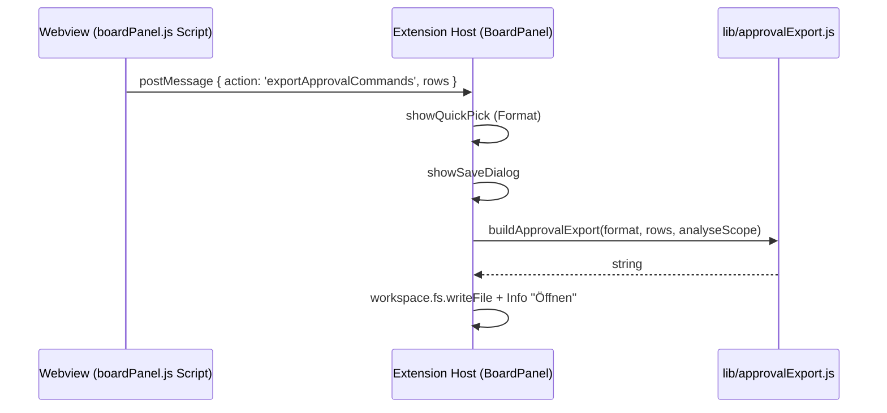

# AI Sessions: Export der freigegebenen Terminal-Befehle

Gilt für die Erweiterung `schueri.ai-sessions`, Basis 0.45.1. Das Feature erweitert die Karte **„Freigaben (Approve) · GitHub Copilot“** im Analyse-Tab um einen Button **Exportieren**. Damit lassen sich alle manuell freigegebenen Terminal-Befehle als CSV, Markdown oder JSON exportieren, damit der Systemadministrator sie für die Whitelist (`chat.tools.terminal.autoApprove`) prüfen kann.

## Anforderungen

- Der Button steht im Kopf der Spalte „Manuell erlaubte Terminal-Befehle“, rechts neben dem Titel. Er nutzt die bestehende CSS-Klasse `cmd-rule-btn`.
- Exportiert wird für den aktuell gewählten Analyse-Zeitraum (Heute, 7 Tage oder 30 Tage).
- Der Export ist ungekürzt und enthält alle Programme und Unterbefehle, nicht nur die Top 8 aus der Anzeige.
- Pro Unterbefehl gibt es eine Zeile, z. B. `git status` oder `git diff`. Programme ohne Unterbefehl-Logik, z. B. `node` oder `Get-ChildItem`, bekommen eine Zeile für das Programm.
- Ruft jemand ein Programm mit Unterbefehl-Logik (z. B. `git`) ohne Unterbefehl auf, erscheint dieser Aufruf nicht im Export. Das ist bewusst so: Die Analyse zählt nur Unterbefehle, eine Freigabe des reinen Programmnamens würde das ganze Programm freigeben.
- Zu jeder Zeile gehören:
  - Befehl, Programm, Unterbefehl, Anzahl
  - „Lesend (Vorschlag)“: `Ja`, wenn der Unterbefehl in der bestehenden Webview-Konstante `SAFE_SUBCOMMANDS` steht, sonst `Nein`
  - ein Regex-Pattern im gleichen Format wie beim Button „Regel kopieren“: `/^git\s+status\b/i` bzw. `/^node\b/i`
- Ablauf:
  1. QuickPick mit dem Format (CSV, Markdown oder JSON)
  2. Speichern-Dialog, Vorschlag `~/Downloads/copilot-freigaben-YYYY-MM-DD.<ext>`
  3. Datei schreiben
  4. Info-Meldung mit dem Button „Öffnen“
- CSV:
  - Trennzeichen `;`, Zeilenende CRLF, UTF-8 mit BOM (für Excel)
  - Schutz vor CSV- bzw. Formel-Injection: Beginnt ein Wert mit `= + - @ Tab CR`, wird ein `'` vorangestellt.
- Bewusst nicht exportiert werden vollständige Kommandozeilen, weil sie Pfade, Tokens oder Passwörter enthalten können. Exportiert werden nur Programm und Unterbefehl, die die Analyse bereits extrahiert.
- Die Daten aus der Webview gelten als nicht vertrauenswürdig. Die Extension-Seite prüft deshalb die Typen und kürzt Felder auf 100 Zeichen.

## Architektur



`rows` aus der Webview haben das Format `{ cmd: string, sub: string, count: number, safe: boolean }`.

## Änderungen im Einzelnen

### 1. `lib/analytics.js`: ungekürzte Befehlsliste bereitstellen

Die Änderung gehört in `aggregateScope()`, Abschnitt „6. Tool approvals“. Bisher wurde `approvals.topCommands` direkt mit `.slice(0, 8)` gebildet. Jetzt entsteht zuerst die vollständige Liste, daraus wird anschließend die Top-8-Liste abgeleitet.

```diff
-  approvals.topCommands = Array.from(manualCommandMap.entries())
+  const allCommands = Array.from(manualCommandMap.entries())
     .map(([name, e]) => ({
       name,
       count: e.count,
       percent: approvals.manual > 0 ? Math.round((e.count / approvals.manual) * 100) : 0,
       re: escapeRegex(name),
       hasSubcommands: SUBCOMMAND_PROGRAMS.has(name),
       subs: Array.from(e.subs.entries())
         .map(([sub, count]) => ({ name: sub, count, re: escapeRegex(sub) }))
         .sort((x, y) => y.count - x.count)
     }))
-    .sort((x, y) => y.count - x.count)
-    .slice(0, 8);
+    .sort((x, y) => y.count - x.count);
+  // Full list (unsliced) for the admin export; the UI only shows the top 8.
+  approvals.allCommands = allCommands;
+  approvals.topCommands = allCommands.slice(0, 8);
```

`COPILOT_TURN_CACHE_VERSION` muss nicht erhöht werden. Die gecachten Turns ändern ihre Struktur nicht, die Aggregation läuft jedes Mal neu.

### 2. Neue Datei `lib/approvalExport.js`

```js
'use strict';

// Export of manually approved Copilot terminal commands (for the admin whitelist review).

const SCOPE_LABELS = { today: 'Heute', '7d': 'Letzte 7 Tage', '30d': 'Letzte 30 Tage' };
const FORMATS = {
  csv: { label: 'CSV (Excel)', ext: 'csv' },
  md: { label: 'Markdown', ext: 'md' },
  json: { label: 'JSON', ext: 'json' }
};

function escapeRegex(str) {
  return str.replace(/[.*+?^${}()|[\]\\]/g, '\\$&');
}

// Validates the rows coming from the webview.
function normalizeRows(rows) {
  const out = [];
  for (const r of Array.isArray(rows) ? rows : []) {
    if (!r || typeof r.cmd !== 'string' || !r.cmd) continue;
    const sub = typeof r.sub === 'string' ? r.sub : '';
    const cmd = r.cmd.slice(0, 100);
    const text = sub ? cmd + ' ' + sub.slice(0, 100) : cmd;
    out.push({
      command: text,
      program: cmd,
      subcommand: sub.slice(0, 100),
      count: Math.max(0, Math.floor(Number(r.count) || 0)),
      readOnly: !!r.safe,
      // Same pattern shape as the "Regel kopieren" button.
      pattern: sub
        ? '/^' + escapeRegex(cmd) + '\\s+' + escapeRegex(sub) + '\\b/i'
        : '/^' + escapeRegex(cmd) + '\\b/i'
    });
  }
  return out;
}

function csvCell(value) {
  let s = String(value);
  // Prevent formula injection when opened in Excel.
  if (/^[=+\-@\t\r]/.test(s)) s = "'" + s;
  return /[;"\r\n]/.test(s) ? '"' + s.replace(/"/g, '""') + '"' : s;
}

function toCsv(rows) {
  const lines = [['Befehl', 'Programm', 'Unterbefehl', 'Anzahl', 'Lesend (Vorschlag)', 'Regex-Pattern (autoApprove)'].join(';')];
  for (const r of rows) {
    lines.push([r.command, r.program, r.subcommand, r.count, r.readOnly ? 'Ja' : 'Nein', r.pattern].map(csvCell).join(';'));
  }
  // BOM so Excel detects UTF-8.
  return '\uFEFF' + lines.join('\r\n') + '\r\n';
}

function mdCell(value) {
  return String(value).replace(/\|/g, '\\|').replace(/\r?\n/g, ' ');
}

function toMarkdown(rows, meta) {
  const lines = [
    '# Manuell freigegebene Terminal-Befehle (GitHub Copilot)',
    '',
    '- Zeitraum: ' + meta.scopeLabel,
    '- Erstellt: ' + meta.createdAt,
    '- Einträge: ' + rows.length,
    '',
    '| Befehl | Anzahl | Lesend (Vorschlag) | Regex-Pattern (autoApprove) |',
    '| --- | ---: | :---: | --- |'
  ];
  for (const r of rows) {
    lines.push('| `' + mdCell(r.command) + '` | ' + r.count + ' | ' + (r.readOnly ? 'Ja' : 'Nein') + ' | `' + mdCell(r.pattern) + '` |');
  }
  return lines.join('\n') + '\n';
}

function toJson(rows, meta) {
  return JSON.stringify({
    source: 'ai-sessions / GitHub Copilot',
    scope: meta.scopeLabel,
    createdAt: meta.createdAtIso,
    commands: rows
  }, null, 2) + '\n';
}

function buildApprovalExport(format, rawRows, scope) {
  const rows = normalizeRows(rawRows);
  const now = new Date();
  const meta = {
    scopeLabel: SCOPE_LABELS[scope] || String(scope || ''),
    createdAtIso: now.toISOString(),
    createdAt: now.toLocaleString('de-DE')
  };
  if (format === 'csv') return toCsv(rows);
  if (format === 'md') return toMarkdown(rows, meta);
  return toJson(rows, meta);
}

module.exports = { FORMATS, buildApprovalExport, normalizeRows };
```

### 3. `lib/boardPanel.js`: Extension-Seite (Node)

**3a. Imports** am Dateianfang, nach `const crypto = require('crypto');`:

```js
const os = require('os');
const path = require('path');
const { FORMATS, buildApprovalExport } = require('./approvalExport');
```

**3b. Message-Handler** in `attach()` innerhalb von `onDidReceiveMessage`, z. B. vor `setAnalyseFilter`:

```js
      if (msg && msg.action === 'exportApprovalCommands') {
        this.exportApprovalCommands(msg.rows);
        return;
      }
```

**3c. Neue Methode** in der Klasse `BoardPanel`, z. B. direkt nach `attach()`:

```js
  async exportApprovalCommands(rows) {
    try {
      if (!Array.isArray(rows) || rows.length === 0) {
        vscode.window.showInformationMessage('Keine Befehle zum Exportieren.');
        return;
      }
      const pick = await vscode.window.showQuickPick(
        Object.entries(FORMATS).map(([key, f]) => ({ label: f.label, key })),
        { placeHolder: 'Export-Format für die freigegebenen Befehle' }
      );
      if (!pick) return;
      const ext = FORMATS[pick.key].ext;
      const stamp = new Date().toISOString().slice(0, 10);
      const target = await vscode.window.showSaveDialog({
        defaultUri: vscode.Uri.file(path.join(os.homedir(), 'Downloads', 'copilot-freigaben-' + stamp + '.' + ext)),
        filters: { [FORMATS[pick.key].label]: [ext] },
        saveLabel: 'Exportieren'
      });
      if (!target) return;
      const content = buildApprovalExport(pick.key, rows, this.analyseScope);
      await vscode.workspace.fs.writeFile(target, Buffer.from(content, 'utf8'));
      const open = await vscode.window.showInformationMessage('Export gespeichert: ' + target.fsPath, 'Öffnen');
      if (open) await vscode.commands.executeCommand('vscode.open', target);
    } catch (err) {
      vscode.window.showErrorMessage('Export fehlgeschlagen: ' + ((err && err.message) || err));
    }
  }
```

`this.analyseScope` wird bereits über die Message `setAnalyseScope` synchron zum gewählten Zeitraum gehalten.

### 4. `lib/boardPanel.js`: Webview-HTML

Gemeint ist die Karte `id="approvals-card"`, Spalte „Manuell erlaubte Terminal-Befehle“. Der Button kommt in den bestehenden `token-comp-header`-Div direkt nach dem `<span class="token-comp-title" ...>`. `.token-comp-header` ist bereits `display:flex; justify-content:space-between`, dadurch landet der Button rechts.

```html
<button class="cmd-rule-btn" id="approvals-export-btn" title="Alle manuell erlaubten Befehle (inkl. Unterbefehle, ungekürzt) als CSV/Markdown/JSON für die Whitelist-Prüfung exportieren">Exportieren</button>
```

### 5. `lib/boardPanel.js`: Webview-Script

> **Wichtig:** Das Webview-Script steht in einem JS-Template-Literal. Darin keine `${`, keine Backticks und keine rohen Backslashes verwenden (`\n` muss als `\\n` geschrieben werden). Der folgende Code kommt ohne diese Zeichen aus.

**5a. State**, neben `let approvalCommands = [];`:

```js
let approvalAllCommands = [];     // ungekürzte Liste für den Export
```

**5b. Click-Handler** vor `function renderApprovals(a, timeline, scope)`:

```js
const approvalsExportBtn = document.getElementById('approvals-export-btn');
if (approvalsExportBtn) {
  approvalsExportBtn.addEventListener('click', () => {
    const rows = [];
    for (const c of approvalAllCommands) {
      const subs = c.hasSubcommands ? (c.subs || []) : [];
      if (subs.length === 0) {
        rows.push({ cmd: c.name, sub: '', count: c.count, safe: false });
      } else {
        for (const s of subs) {
          rows.push({ cmd: c.name, sub: s.name, count: s.count, safe: SAFE_SUBCOMMANDS.has(c.name + ' ' + s.name) });
        }
      }
    }
    vscode.postMessage({ action: 'exportApprovalCommands', rows });
  });
}
```

**5c. In `renderApprovals()`**:

Im Leer-Zweig (`if (!a || a.total === 0) { ... }`), nach `approvalCommands = [];`:

```js
    approvalAllCommands = [];
```

Bei „Top Commands“, nach `approvalCommands = a.topCommands || [];`:

```js
  approvalAllCommands = a.allCommands || approvalCommands;
```

## Test

1. `node test/check-webviews.js` muss „Webview-Script Syntax OK“ melden.
2. Exporter isoliert testen:
   ```powershell
   node -e "const m=require('./lib/approvalExport');const r=[{cmd:'git',sub:'status',count:5,safe:true},{cmd:'node',sub:'',count:2},{cmd:'=x',sub:'',count:1}];console.log(m.buildApprovalExport('csv',r,'7d'))"
   ```
   Erwartet:
   ```
   Befehl;Programm;Unterbefehl;Anzahl;Lesend (Vorschlag);Regex-Pattern (autoApprove)
   git status;git;status;5;Ja;/^git\s+status\b/i
   node;node;;2;Nein;/^node\b/i
   '=x;'=x;;1;Nein;/^=x\b/i
   ```
3. Manuell im Dashboard prüfen:
   1. Fenster neu laden.
   2. AI Sessions öffnen, Tab Analyse, Zeitraum wählen.
   3. Auf „Exportieren“ klicken, Format wählen und speichern.
   4. Datei öffnen und prüfen.
   5. Ohne Freigabe-Daten muss die Meldung „Keine Befehle zum Exportieren.“ erscheinen.

## Optional (nicht umgesetzt)

- Zusätzliche Spalte mit der fertigen Zeile für `settings.json` (`"<pattern>": true`).
- Den Export zusätzlich als Command in `package.json` registrieren (Command Palette).
- Changelog bzw. README ergänzen und die Version erhöhen.
